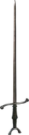
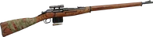
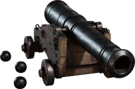
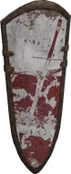
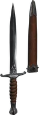
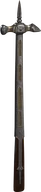
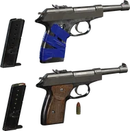
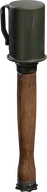

# Poly Haven: Weapons models

**13 assets from [Poly Haven](https://polyhaven.com), dedicated to the public domain under [CC0](https://polyhaven.com/license).** Use them in any game, free or paid, and change them however you like; no credit is needed.

3D models as glTF at 1K and 2K texture resolution, each folder self-contained (`.gltf`, `.bin`, `textures/`). 158.2 MB in all.

This is a copy kept by [zuujis-cc0](https://github.com/zuujis-cc0) so game makers can take single files from GitHub. It is not made by or affiliated with Poly Haven: the originals, often in more formats and higher resolutions, are on [polyhaven.com](https://polyhaven.com). If they help you, consider [supporting Poly Haven](https://www.patreon.com/polyhaven/overview).

Every file is listed in [MANIFEST.tsv](MANIFEST.tsv) with its size and SHA-256. More free assets: [the Zuujis collection](https://github.com/zuujis-cc0/free-game-assets#readme).

| | | | |
| :-: | :-: | :-: | :-: |
|  <b><a href="antique_estoc">Antique Estoc</a></b> by James Ray Cock, Ulan Cabanilla · <a href="https://polyhaven.com/a/antique_estoc">source</a> |  <b><a href="antique_katana_01">Antique Katana 01</a></b> by Tal Swicegood · <a href="https://polyhaven.com/a/antique_katana_01">source</a> |  <b><a href="bolt_action_rifle_7_62">Bolt Action Rifle 7.62</a></b> by Mateusz Sadek · <a href="https://polyhaven.com/a/bolt_action_rifle_7_62">source</a> |  <b><a href="cannon_01">Cannon 01</a></b> by James Ray Cock, Yann Kervran · <a href="https://polyhaven.com/a/cannon_01">source</a> |
|  <b><a href="fish_knife">Fish Knife</a></b> by Mateusz Sadek · <a href="https://polyhaven.com/a/fish_knife">source</a> |  <b><a href="kite_shield">Kite Shield</a></b> by Ulan Cabanilla · <a href="https://polyhaven.com/a/kite_shield">source</a> |  <b><a href="machete">Machete</a></b> by Ulan Cabanilla · <a href="https://polyhaven.com/a/machete">source</a> |  <b><a href="ornate_medieval_dagger">Ornate Medieval Dagger</a></b> by Sofia Pahaoja · <a href="https://polyhaven.com/a/ornate_medieval_dagger">source</a> |
|  <b><a href="ornate_medieval_mace">Ornate Medieval Mace</a></b> by Ulan Cabanilla · <a href="https://polyhaven.com/a/ornate_medieval_mace">source</a> |  <b><a href="ornate_war_hammer">Ornate War Hammer</a></b> by James Ray Cock, Ulan Cabanilla · <a href="https://polyhaven.com/a/ornate_war_hammer">source</a> |  <b><a href="service_pistol">Service Pistol</a></b> by Mateusz Sadek · <a href="https://polyhaven.com/a/service_pistol">source</a> |  <b><a href="stick_grenade">Stick Grenade</a></b> by singaii · <a href="https://polyhaven.com/a/stick_grenade">source</a> |
|  <b><a href="wooden_handle_saber">Wooden Handle Saber</a></b> by Ulan Cabanilla · <a href="https://polyhaven.com/a/wooden_handle_saber">source</a> |  |  |  |

---

Kept up to date by this repository's own [update workflow](.github/workflows/update.yml), with code and plan from [cc0-mirror](https://github.com/zuujis-cc0/cc0-mirror). Something wrong? [Open an issue there](https://github.com/zuujis-cc0/cc0-mirror/issues/new) or use the [private report form](https://games.zuujis.com/report).
